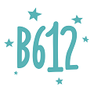

# 可莉插件明文快照目录

采集日期为 2026-11-10，当前目录提供 272 个明文配置，包含去广告、签到、节点检测等网站现有分类。

快照安装链接固定到 `kelee-snapshot-2026-11-10` 标签，插件与已发现的静态脚本、JQ、图标依赖都从本仓库读取。直播吧条目使用 `main` 分支的合并版，由可莉规则与落痕广告配置脚本组成。

本目录的状态表示下载完整性。脚本中的运行时网络请求、用户自定义源、动态生成的下载地址仍由其代码决定，安全审阅状态均为待审阅。

[快照说明](../../vendor/kelee/README.md) · [静态检查标记](../../vendor/kelee/REVIEW.md)

## 去广告及依赖

| 插件 | 分类 | 配置与脚本 | 资源状态 | 安装 |
| --- | --- | --- | --- | --- |
|  [HTTPDNS拦截器](Block_HTTPDNS.plugin) | 去广告、依赖 | 规则 / 复写配置 | 静态依赖已归档 | [固定快照](https://raw.githubusercontent.com/CodeApe-Xiaoyin/loon-plugins/kelee-snapshot-2026-11-10/plugins/kelee/Block_HTTPDNS.plugin) |
|  [广告平台拦截器](BlockAdvertisers.plugin) | 去广告、依赖 | 规则 / 复写配置 | 静态依赖已归档 | [固定快照](https://raw.githubusercontent.com/CodeApe-Xiaoyin/loon-plugins/kelee-snapshot-2026-11-10/plugins/kelee/BlockAdvertisers.plugin) |
|  [5EPlay去广告](5EPlay_remove_ads.plugin) | 去广告 | 规则 / 复写配置 | 静态依赖已归档 | [固定快照](https://raw.githubusercontent.com/CodeApe-Xiaoyin/loon-plugins/kelee-snapshot-2026-11-10/plugins/kelee/5EPlay_remove_ads.plugin) |
|  [36氪去广告](36Kr_remove_ads.plugin) | 去广告 | 规则 / 复写配置 | 静态依赖已归档 | [固定快照](https://raw.githubusercontent.com/CodeApe-Xiaoyin/loon-plugins/kelee-snapshot-2026-11-10/plugins/kelee/36Kr_remove_ads.plugin) |
|  [123云盘去广告](123NetWorkDisk_remove_ads.plugin) | 去广告 | 规则 / 复写配置 | 静态依赖已归档 | [固定快照](https://raw.githubusercontent.com/CodeApe-Xiaoyin/loon-plugins/kelee-snapshot-2026-11-10/plugins/kelee/123NetWorkDisk_remove_ads.plugin) |
|  [360摄像机去广告](360SmartCamera_remove_ads.plugin) | 去广告 | 规则 / 复写配置 | 静态依赖已归档 | [固定快照](https://raw.githubusercontent.com/CodeApe-Xiaoyin/loon-plugins/kelee-snapshot-2026-11-10/plugins/kelee/360SmartCamera_remove_ads.plugin) |
|  [360智慧生活去广告](SafetyHome_remove_ads.plugin) | 去广告 | 规则 / 复写配置 | 静态依赖已归档 | [固定快照](https://raw.githubusercontent.com/CodeApe-Xiaoyin/loon-plugins/kelee-snapshot-2026-11-10/plugins/kelee/SafetyHome_remove_ads.plugin) |
|  [555电影去广告](555DY_remove_ads.plugin) | 去广告 | 规则 / 复写配置 | 静态依赖已归档 | [固定快照](https://raw.githubusercontent.com/CodeApe-Xiaoyin/loon-plugins/kelee-snapshot-2026-11-10/plugins/kelee/555DY_remove_ads.plugin) |
|  [12306去广告](12306_remove_ads.plugin) | 去广告 | 脚本 1 项 | 静态依赖已归档 | [固定快照](https://raw.githubusercontent.com/CodeApe-Xiaoyin/loon-plugins/kelee-snapshot-2026-11-10/plugins/kelee/12306_remove_ads.plugin) |
|  [B612咔叽去广告](SnowCamera_remove_ads.plugin) | 去广告 | 规则 / 复写配置 | 静态依赖已归档 | [固定快照](https://raw.githubusercontent.com/CodeApe-Xiaoyin/loon-plugins/kelee-snapshot-2026-11-10/plugins/kelee/SnowCamera_remove_ads.plugin) |
|  [CC直播去广告](CCLive_remove_ads.plugin) | 去广告 | 规则 / 复写配置 | 静态依赖已归档 | [固定快照](https://raw.githubusercontent.com/CodeApe-Xiaoyin/loon-plugins/kelee-snapshot-2026-11-10/plugins/kelee/CCLive_remove_ads.plugin) |
|  [DJ多多去广告](DjDuoDuo_remove_ads.plugin) | 去广告 | 脚本 1 项 | 静态依赖已归档 | [固定快照](https://raw.githubusercontent.com/CodeApe-Xiaoyin/loon-plugins/kelee-snapshot-2026-11-10/plugins/kelee/DjDuoDuo_remove_ads.plugin) |
|  [Dlabel云标签去广告](Dlabel_remove_ads.plugin) | 去广告 | 规则 / 复写配置 | 静态依赖已归档 | [固定快照](https://raw.githubusercontent.com/CodeApe-Xiaoyin/loon-plugins/kelee-snapshot-2026-11-10/plugins/kelee/Dlabel_remove_ads.plugin) |
|  [DREAME去广告](DREAME_remove_ads.plugin) | 去广告 | 规则 / 复写配置 | 静态依赖已归档 | [固定快照](https://raw.githubusercontent.com/CodeApe-Xiaoyin/loon-plugins/kelee-snapshot-2026-11-10/plugins/kelee/DREAME_remove_ads.plugin) |
|  [ECOVACS HOME去广告](EcovacsHome_remove_ads.plugin) | 去广告 | 规则 / 复写配置 | 静态依赖已归档 | [固定快照](https://raw.githubusercontent.com/CodeApe-Xiaoyin/loon-plugins/kelee-snapshot-2026-11-10/plugins/kelee/EcovacsHome_remove_ads.plugin) |
|  [e充电去广告](EasyCharge_remove_ads.plugin) | 去广告 | 规则 / 复写配置 | 静态依赖已归档 | [固定快照](https://raw.githubusercontent.com/CodeApe-Xiaoyin/loon-plugins/kelee-snapshot-2026-11-10/plugins/kelee/EasyCharge_remove_ads.plugin) |
|  [Foodie去广告](Foodie_remove_ads.plugin) | 去广告 | 规则 / 复写配置 | 静态依赖已归档 | [固定快照](https://raw.githubusercontent.com/CodeApe-Xiaoyin/loon-plugins/kelee-snapshot-2026-11-10/plugins/kelee/Foodie_remove_ads.plugin) |
|  [Google搜索重定向](Google.plugin) | 去广告 | 规则 / 复写配置 | 静态依赖已归档 | [固定快照](https://raw.githubusercontent.com/CodeApe-Xiaoyin/loon-plugins/kelee-snapshot-2026-11-10/plugins/kelee/Google.plugin) |
|  [Hong Kong Toolbar去广告](HongKongToolbar_remove_ads.plugin) | 去广告 | 规则 / 复写配置 | 静态依赖已归档 | [固定快照](https://raw.githubusercontent.com/CodeApe-Xiaoyin/loon-plugins/kelee-snapshot-2026-11-10/plugins/kelee/HongKongToolbar_remove_ads.plugin) |
|  [IT之家去广告](IThome_remove_ads.plugin) | 去广告 | 脚本 1 项 | 静态依赖已归档 | [固定快照](https://raw.githubusercontent.com/CodeApe-Xiaoyin/loon-plugins/kelee-snapshot-2026-11-10/plugins/kelee/IThome_remove_ads.plugin) |
|  [Jump去广告](Jump_remove_ads.plugin) | 去广告 | 规则 / 复写配置 | 静态依赖已归档 | [固定快照](https://raw.githubusercontent.com/CodeApe-Xiaoyin/loon-plugins/kelee-snapshot-2026-11-10/plugins/kelee/Jump_remove_ads.plugin) |
|  [Keep去广告](Keep_remove_ads.plugin) | 去广告 | 规则 / 复写配置 | 静态依赖已归档 | [固定快照](https://raw.githubusercontent.com/CodeApe-Xiaoyin/loon-plugins/kelee-snapshot-2026-11-10/plugins/kelee/Keep_remove_ads.plugin) |
|  [KOOK去广告](KOOK_remove_ads.plugin) | 去广告 | 规则 / 复写配置 | 静态依赖已归档 | [固定快照](https://raw.githubusercontent.com/CodeApe-Xiaoyin/loon-plugins/kelee-snapshot-2026-11-10/plugins/kelee/KOOK_remove_ads.plugin) |
|  [Line去广告](Line_remove_ads.plugin) | 去广告 | 规则 / 复写配置 | 静态依赖已归档 | [固定快照](https://raw.githubusercontent.com/CodeApe-Xiaoyin/loon-plugins/kelee-snapshot-2026-11-10/plugins/kelee/Line_remove_ads.plugin) |
|  [OKOK去广告](OKOK_remove_ads.plugin) | 去广告 | 规则 / 复写配置 | 静态依赖已归档 | [固定快照](https://raw.githubusercontent.com/CodeApe-Xiaoyin/loon-plugins/kelee-snapshot-2026-11-10/plugins/kelee/OKOK_remove_ads.plugin) |
|  [PICOOC去广告](PICOOC_remove_ads.plugin) | 去广告 | 规则 / 复写配置 | 静态依赖已归档 | [固定快照](https://raw.githubusercontent.com/CodeApe-Xiaoyin/loon-plugins/kelee-snapshot-2026-11-10/plugins/kelee/PICOOC_remove_ads.plugin) |
|  [Pinterest去广告](Pinterest_remove_ads.plugin) | 去广告 | 规则 / 复写配置 | 静态依赖已归档 | [固定快照](https://raw.githubusercontent.com/CodeApe-Xiaoyin/loon-plugins/kelee-snapshot-2026-11-10/plugins/kelee/Pinterest_remove_ads.plugin) |
|  [QQ链接解锁](QQ_Redirect.plugin) | 去广告 | 规则 / 复写配置 | 静态依赖已归档 | [固定快照](https://raw.githubusercontent.com/CodeApe-Xiaoyin/loon-plugins/kelee-snapshot-2026-11-10/plugins/kelee/QQ_Redirect.plugin) |
|  [QQ音乐去广告](QQMusic_remove_ads.plugin) | 去广告 | 规则 / 复写配置 | 静态依赖已归档 | [固定快照](https://raw.githubusercontent.com/CodeApe-Xiaoyin/loon-plugins/kelee-snapshot-2026-11-10/plugins/kelee/QQMusic_remove_ads.plugin) |
|  [Reddit去广告](Reddit_remove_ads.plugin) | 去广告 | 规则 / 复写配置 | 静态依赖已归档 | [固定快照](https://raw.githubusercontent.com/CodeApe-Xiaoyin/loon-plugins/kelee-snapshot-2026-11-10/plugins/kelee/Reddit_remove_ads.plugin) |
|  [ReelShort去广告](ReelShort_remove_ads.plugin) | 去广告 | 规则 / 复写配置 | 静态依赖已归档 | [固定快照](https://raw.githubusercontent.com/CodeApe-Xiaoyin/loon-plugins/kelee-snapshot-2026-11-10/plugins/kelee/ReelShort_remove_ads.plugin) |
|  [Roborock去广告](Roborock_remove_ads.plugin) | 去广告 | 规则 / 复写配置 | 静态依赖已归档 | [固定快照](https://raw.githubusercontent.com/CodeApe-Xiaoyin/loon-plugins/kelee-snapshot-2026-11-10/plugins/kelee/Roborock_remove_ads.plugin) |
|  [RQrun去广告](RQrun_remove_ads.plugin) | 去广告 | 规则 / 复写配置 | 静态依赖已归档 | [固定快照](https://raw.githubusercontent.com/CodeApe-Xiaoyin/loon-plugins/kelee-snapshot-2026-11-10/plugins/kelee/RQrun_remove_ads.plugin) |
|  [Sofascore去广告](Sofascore_remove_ads.plugin) | 去广告 | 规则 / 复写配置 | 静态依赖已归档 | [固定快照](https://raw.githubusercontent.com/CodeApe-Xiaoyin/loon-plugins/kelee-snapshot-2026-11-10/plugins/kelee/Sofascore_remove_ads.plugin) |
|  [Soul去广告](Soul_remove_ads.plugin) | 去广告 | 脚本 1 项 | 静态依赖已归档 | [固定快照](https://raw.githubusercontent.com/CodeApe-Xiaoyin/loon-plugins/kelee-snapshot-2026-11-10/plugins/kelee/Soul_remove_ads.plugin) |
|  [Spotify去广告](Spotify_remove_ads.plugin) | 去广告 | 脚本 1 项 | 静态依赖已归档 | [固定快照](https://raw.githubusercontent.com/CodeApe-Xiaoyin/loon-plugins/kelee-snapshot-2026-11-10/plugins/kelee/Spotify_remove_ads.plugin) |
|  [Telegram重定向](TelegramRedirect.plugin) | 去广告 | 规则 / 复写配置 | 静态依赖已归档 | [固定快照](https://raw.githubusercontent.com/CodeApe-Xiaoyin/loon-plugins/kelee-snapshot-2026-11-10/plugins/kelee/TelegramRedirect.plugin) |
|  [TeraBox去广告](TeraBox_remove_ads.plugin) | 去广告 | 规则 / 复写配置 | 静态依赖已归档 | [固定快照](https://raw.githubusercontent.com/CodeApe-Xiaoyin/loon-plugins/kelee-snapshot-2026-11-10/plugins/kelee/TeraBox_remove_ads.plugin) |
|  [TubeMax去广告](TubeMax_remove_ads.plugin) | 去广告 | 规则 / 复写配置 | 静态依赖已归档 | [固定快照](https://raw.githubusercontent.com/CodeApe-Xiaoyin/loon-plugins/kelee-snapshot-2026-11-10/plugins/kelee/TubeMax_remove_ads.plugin) |
|  [Tumblr去广告](Tumblr_remove_ads.plugin) | 去广告 | 规则 / 复写配置 | 静态依赖已归档 | [固定快照](https://raw.githubusercontent.com/CodeApe-Xiaoyin/loon-plugins/kelee-snapshot-2026-11-10/plugins/kelee/Tumblr_remove_ads.plugin) |
|  [Uki去广告](Uki_remove_ads.plugin) | 去广告 | 脚本 1 项 | 静态依赖已归档 | [固定快照](https://raw.githubusercontent.com/CodeApe-Xiaoyin/loon-plugins/kelee-snapshot-2026-11-10/plugins/kelee/Uki_remove_ads.plugin) |
|  [WakeUp课程表去广告](WakeupSchedule_remove_ads.plugin) | 去广告 | 规则 / 复写配置 | 静态依赖已归档 | [固定快照](https://raw.githubusercontent.com/CodeApe-Xiaoyin/loon-plugins/kelee-snapshot-2026-11-10/plugins/kelee/WakeupSchedule_remove_ads.plugin) |
|  [YouTube去广告](YouTube_remove_ads.plugin) | 去广告 | 脚本 2 项 | 静态依赖已归档 | [固定快照](https://raw.githubusercontent.com/CodeApe-Xiaoyin/loon-plugins/kelee-snapshot-2026-11-10/plugins/kelee/YouTube_remove_ads.plugin) |
|  [YY去广告](YY_Voice_remove_ads.plugin) | 去广告 | 规则 / 复写配置 | 静态依赖已归档 | [固定快照](https://raw.githubusercontent.com/CodeApe-Xiaoyin/loon-plugins/kelee-snapshot-2026-11-10/plugins/kelee/YY_Voice_remove_ads.plugin) |
|  [YY语音去广告](YYVoiceTool_remove_ads.plugin) | 去广告 | 规则 / 复写配置 | 静态依赖已归档 | [固定快照](https://raw.githubusercontent.com/CodeApe-Xiaoyin/loon-plugins/kelee-snapshot-2026-11-10/plugins/kelee/YYVoiceTool_remove_ads.plugin) |
|  [ZAKER去广告](ZAKER_remove_ads.plugin) | 去广告 | 规则 / 复写配置 | 静态依赖已归档 | [固定快照](https://raw.githubusercontent.com/CodeApe-Xiaoyin/loon-plugins/kelee-snapshot-2026-11-10/plugins/kelee/ZAKER_remove_ads.plugin) |
|  [爱企查去广告](Aiinquiry_remove_ads.plugin) | 去广告 | 规则 / 复写配置 | 静态依赖已归档 | [固定快照](https://raw.githubusercontent.com/CodeApe-Xiaoyin/loon-plugins/kelee-snapshot-2026-11-10/plugins/kelee/Aiinquiry_remove_ads.plugin) |
|  [爱奇艺去广告](iQiYi_Video_remove_ads.plugin) | 去广告 | 规则 / 复写配置 | 静态依赖已归档 | [固定快照](https://raw.githubusercontent.com/CodeApe-Xiaoyin/loon-plugins/kelee-snapshot-2026-11-10/plugins/kelee/iQiYi_Video_remove_ads.plugin) |
|  [阿里云盘去广告](AliYunDrive_remove_ads.plugin) | 去广告 | 脚本 1 项 | 静态依赖已归档 | [固定快照](https://raw.githubusercontent.com/CodeApe-Xiaoyin/loon-plugins/kelee-snapshot-2026-11-10/plugins/kelee/AliYunDrive_remove_ads.plugin) |
|  [百度地图去广告](BaiduMap_remove_ads.plugin) | 去广告 | 规则 / 复写配置 | 静态依赖已归档 | [固定快照](https://raw.githubusercontent.com/CodeApe-Xiaoyin/loon-plugins/kelee-snapshot-2026-11-10/plugins/kelee/BaiduMap_remove_ads.plugin) |
|  [百度翻译去广告](BaiduTranslate_remove_ads.plugin) | 去广告 | 规则 / 复写配置 | 静态依赖已归档 | [固定快照](https://raw.githubusercontent.com/CodeApe-Xiaoyin/loon-plugins/kelee-snapshot-2026-11-10/plugins/kelee/BaiduTranslate_remove_ads.plugin) |
|  [百度输入法去广告](Baidu_input_method_remove_ads.plugin) | 去广告 | 脚本 1 项 | 静态依赖已归档 | [固定快照](https://raw.githubusercontent.com/CodeApe-Xiaoyin/loon-plugins/kelee-snapshot-2026-11-10/plugins/kelee/Baidu_input_method_remove_ads.plugin) |
|  [百度贴吧去广告](Tieba_remove_ads.plugin) | 去广告 | 脚本 1 项 | 静态依赖已归档 | [固定快照](https://raw.githubusercontent.com/CodeApe-Xiaoyin/loon-plugins/kelee-snapshot-2026-11-10/plugins/kelee/Tieba_remove_ads.plugin) |
|  [百度网盘去广告](BaiduNetDisk_remove_ads.plugin) | 去广告 | 规则 / 复写配置 | 静态依赖已归档 | [固定快照](https://raw.githubusercontent.com/CodeApe-Xiaoyin/loon-plugins/kelee-snapshot-2026-11-10/plugins/kelee/BaiduNetDisk_remove_ads.plugin) |
|  [百度网页去广告](BaiduSearchWebpage_remove_ads.plugin) | 去广告 | 脚本 1 项 | 静态依赖已归档 | [固定快照](https://raw.githubusercontent.com/CodeApe-Xiaoyin/loon-plugins/kelee-snapshot-2026-11-10/plugins/kelee/BaiduSearchWebpage_remove_ads.plugin) |
|  [百度文库去广告](BaiduWenku_remove_ads.plugin) | 去广告 | 规则 / 复写配置 | 静态依赖已归档 | [固定快照](https://raw.githubusercontent.com/CodeApe-Xiaoyin/loon-plugins/kelee-snapshot-2026-11-10/plugins/kelee/BaiduWenku_remove_ads.plugin) |
|  [宝宝树孕育去广告](BabyTree_remove_ads.plugin) | 去广告 | 脚本 1 项 | 静态依赖已归档 | [固定快照](https://raw.githubusercontent.com/CodeApe-Xiaoyin/loon-plugins/kelee-snapshot-2026-11-10/plugins/kelee/BabyTree_remove_ads.plugin) |
|  [贝壳找房去广告](Beike_remove_ads.plugin) | 去广告 | 规则 / 复写配置 | 静态依赖已归档 | [固定快照](https://raw.githubusercontent.com/CodeApe-Xiaoyin/loon-plugins/kelee-snapshot-2026-11-10/plugins/kelee/Beike_remove_ads.plugin) |
|  [哔哩哔哩漫画去广告](BiliComic_remove_ads.plugin) | 去广告 | 脚本 1 项 | 静态依赖已归档 | [固定快照](https://raw.githubusercontent.com/CodeApe-Xiaoyin/loon-plugins/kelee-snapshot-2026-11-10/plugins/kelee/BiliComic_remove_ads.plugin) |
|  [哔哩哔哩去广告](Bilibili_remove_ads.plugin) | 去广告 | 脚本 3 项 | 静态依赖已归档 | [固定快照](https://raw.githubusercontent.com/CodeApe-Xiaoyin/loon-plugins/kelee-snapshot-2026-11-10/plugins/kelee/Bilibili_remove_ads.plugin) |
|  [比特球云盘去广告](BitqiuPan_remove_ads.plugin) | 去广告 | 规则 / 复写配置 | 静态依赖已归档 | [固定快照](https://raw.githubusercontent.com/CodeApe-Xiaoyin/loon-plugins/kelee-snapshot-2026-11-10/plugins/kelee/BitqiuPan_remove_ads.plugin) |
|  [比心去广告](Bixin_remove_ads.plugin) | 去广告 | 脚本 2 项 | 静态依赖已归档 | [固定快照](https://raw.githubusercontent.com/CodeApe-Xiaoyin/loon-plugins/kelee-snapshot-2026-11-10/plugins/kelee/Bixin_remove_ads.plugin) |
|  [波点音乐去广告](BodianMusic_remove_ads.plugin) | 去广告 | 规则 / 复写配置 | 静态依赖已归档 | [固定快照](https://raw.githubusercontent.com/CodeApe-Xiaoyin/loon-plugins/kelee-snapshot-2026-11-10/plugins/kelee/BodianMusic_remove_ads.plugin) |
|  [薄荷健康去广告](BooHee_remove_ads.plugin) | 去广告 | 脚本 1 项 | 静态依赖已归档 | [固定快照](https://raw.githubusercontent.com/CodeApe-Xiaoyin/loon-plugins/kelee-snapshot-2026-11-10/plugins/kelee/BooHee_remove_ads.plugin) |
|  [菜鸟去广告](Cainiao_remove_ads.plugin) | 去广告 | 规则 / 复写配置 | 静态依赖已归档 | [固定快照](https://raw.githubusercontent.com/CodeApe-Xiaoyin/loon-plugins/kelee-snapshot-2026-11-10/plugins/kelee/Cainiao_remove_ads.plugin) |
|  [财新去广告](CaixinMedia_remove_ads.plugin) | 去广告 | 脚本 1 项 | 静态依赖已归档 | [固定快照](https://raw.githubusercontent.com/CodeApe-Xiaoyin/loon-plugins/kelee-snapshot-2026-11-10/plugins/kelee/CaixinMedia_remove_ads.plugin) |
|  [彩云天气去广告](ColorfulClouds_remove_ads.plugin) | 去广告 | 脚本 1 项 | 静态依赖已归档 | [固定快照](https://raw.githubusercontent.com/CodeApe-Xiaoyin/loon-plugins/kelee-snapshot-2026-11-10/plugins/kelee/ColorfulClouds_remove_ads.plugin) |
|  [测测去广告](Cece_remove_ads.plugin) | 去广告 | 规则 / 复写配置 | 静态依赖已归档 | [固定快照](https://raw.githubusercontent.com/CodeApe-Xiaoyin/loon-plugins/kelee-snapshot-2026-11-10/plugins/kelee/Cece_remove_ads.plugin) |
|  [超级课程表去广告](MyFriday_remove_ads.plugin) | 去广告 | 规则 / 复写配置 | 静态依赖已归档 | [固定快照](https://raw.githubusercontent.com/CodeApe-Xiaoyin/loon-plugins/kelee-snapshot-2026-11-10/plugins/kelee/MyFriday_remove_ads.plugin) |
|  [车来了去广告](Chelaile_remove_ads.plugin) | 去广告 | 脚本 1 项 | 静态依赖已归档 | [固定快照](https://raw.githubusercontent.com/CodeApe-Xiaoyin/loon-plugins/kelee-snapshot-2026-11-10/plugins/kelee/Chelaile_remove_ads.plugin) |
|  [成分喵去广告](ChengFenMiao_remove_ads.plugin) | 去广告 | 规则 / 复写配置 | 静态依赖已归档 | [固定快照](https://raw.githubusercontent.com/CodeApe-Xiaoyin/loon-plugins/kelee-snapshot-2026-11-10/plugins/kelee/ChengFenMiao_remove_ads.plugin) |
|  [创维智慧云去广告](SkyworthDigitalPicamera_remove_ads.plugin) | 去广告 | 规则 / 复写配置 | 静态依赖已归档 | [固定快照](https://raw.githubusercontent.com/CodeApe-Xiaoyin/loon-plugins/kelee-snapshot-2026-11-10/plugins/kelee/SkyworthDigitalPicamera_remove_ads.plugin) |
|  [触站去广告](Chuzhan_remove_ads.plugin) | 去广告 | 规则 / 复写配置 | 静态依赖已归档 | [固定快照](https://raw.githubusercontent.com/CodeApe-Xiaoyin/loon-plugins/kelee-snapshot-2026-11-10/plugins/kelee/Chuzhan_remove_ads.plugin) |
|  [磁力宅播放器去广告](XFuse_remove_ads.plugin) | 去广告 | 规则 / 复写配置 | 静态依赖已归档 | [固定快照](https://raw.githubusercontent.com/CodeApe-Xiaoyin/loon-plugins/kelee-snapshot-2026-11-10/plugins/kelee/XFuse_remove_ads.plugin) |
|  [大麦去广告](Damai_remove_ads.plugin) | 去广告 | 规则 / 复写配置 | 静态依赖已归档 | [固定快照](https://raw.githubusercontent.com/CodeApe-Xiaoyin/loon-plugins/kelee-snapshot-2026-11-10/plugins/kelee/Damai_remove_ads.plugin) |
|  [大姨妈月经期助手去广告](Dayima_remove_ads.plugin) | 去广告 | 规则 / 复写配置 | 静态依赖已归档 | [固定快照](https://raw.githubusercontent.com/CodeApe-Xiaoyin/loon-plugins/kelee-snapshot-2026-11-10/plugins/kelee/Dayima_remove_ads.plugin) |
|  [得间小说去广告](iReaderDejian_remove_ads.plugin) | 去广告 | 规则 / 复写配置 | 静态依赖已归档 | [固定快照](https://raw.githubusercontent.com/CodeApe-Xiaoyin/loon-plugins/kelee-snapshot-2026-11-10/plugins/kelee/iReaderDejian_remove_ads.plugin) |
|  [得物去广告](Dewu_remove_ads.plugin) | 去广告 | 规则 / 复写配置 | 静态依赖已归档 | [固定快照](https://raw.githubusercontent.com/CodeApe-Xiaoyin/loon-plugins/kelee-snapshot-2026-11-10/plugins/kelee/Dewu_remove_ads.plugin) |
|  [滴答出行去广告](DidaPincheTaxi_remove_ads.plugin) | 去广告 | 规则 / 复写配置 | 静态依赖已归档 | [固定快照](https://raw.githubusercontent.com/CodeApe-Xiaoyin/loon-plugins/kelee-snapshot-2026-11-10/plugins/kelee/DidaPincheTaxi_remove_ads.plugin) |
|  [滴滴去广告](DiDi_remove_ads.plugin) | 去广告 | 规则 / 复写配置 | 静态依赖已归档 | [固定快照](https://raw.githubusercontent.com/CodeApe-Xiaoyin/loon-plugins/kelee-snapshot-2026-11-10/plugins/kelee/DiDi_remove_ads.plugin) |
|  [叮咚买菜去广告](DingdongMaicai_remove_ads.plugin) | 去广告 | 规则 / 复写配置 | 静态依赖已归档 | [固定快照](https://raw.githubusercontent.com/CodeApe-Xiaoyin/loon-plugins/kelee-snapshot-2026-11-10/plugins/kelee/DingdongMaicai_remove_ads.plugin) |
|  [豆瓣去广告](DouBan_remove_ads.plugin) | 去广告 | 规则 / 复写配置 | 静态依赖已归档 | [固定快照](https://raw.githubusercontent.com/CodeApe-Xiaoyin/loon-plugins/kelee-snapshot-2026-11-10/plugins/kelee/DouBan_remove_ads.plugin) |
|  [豆瓣阅读去广告](DoubanRead_remove_ads.plugin) | 去广告 | 规则 / 复写配置 | 静态依赖已归档 | [固定快照](https://raw.githubusercontent.com/CodeApe-Xiaoyin/loon-plugins/kelee-snapshot-2026-11-10/plugins/kelee/DoubanRead_remove_ads.plugin) |
|  [斗鱼去广告](Douyu_remove_ads.plugin) | 去广告 | 脚本 1 项 | 静态依赖已归档 | [固定快照](https://raw.githubusercontent.com/CodeApe-Xiaoyin/loon-plugins/kelee-snapshot-2026-11-10/plugins/kelee/Douyu_remove_ads.plugin) |
|  [堆糖去广告](DuiTang_remove_ads.plugin) | 去广告 | 规则 / 复写配置 | 静态依赖已归档 | [固定快照](https://raw.githubusercontent.com/CodeApe-Xiaoyin/loon-plugins/kelee-snapshot-2026-11-10/plugins/kelee/DuiTang_remove_ads.plugin) |
|  [多屏互动去广告](TCLnScreen_remove_ads.plugin) | 去广告 | 规则 / 复写配置 | 静态依赖已归档 | [固定快照](https://raw.githubusercontent.com/CodeApe-Xiaoyin/loon-plugins/kelee-snapshot-2026-11-10/plugins/kelee/TCLnScreen_remove_ads.plugin) |
|  [番茄小说去广告](DragonRead_remove_ads.plugin) | 去广告 | 规则 / 复写配置 | 静态依赖已归档 | [固定快照](https://raw.githubusercontent.com/CodeApe-Xiaoyin/loon-plugins/kelee-snapshot-2026-11-10/plugins/kelee/DragonRead_remove_ads.plugin) |
|  [帆书去广告](KebidaDushu_remove_ads.plugin) | 去广告 | 脚本 1 项 | 静态依赖已归档 | [固定快照](https://raw.githubusercontent.com/CodeApe-Xiaoyin/loon-plugins/kelee-snapshot-2026-11-10/plugins/kelee/KebidaDushu_remove_ads.plugin) |
|  [飞客去广告](FlyerTea_remove_ads.plugin) | 去广告 | 脚本 1 项 | 静态依赖已归档 | [固定快照](https://raw.githubusercontent.com/CodeApe-Xiaoyin/loon-plugins/kelee-snapshot-2026-11-10/plugins/kelee/FlyerTea_remove_ads.plugin) |
|  [飞猪旅行去广告](TaobaoTravel_remove_ads.plugin) | 去广告 | 规则 / 复写配置 | 静态依赖已归档 | [固定快照](https://raw.githubusercontent.com/CodeApe-Xiaoyin/loon-plugins/kelee-snapshot-2026-11-10/plugins/kelee/TaobaoTravel_remove_ads.plugin) |
|  [粉笔去广告](FenBi_remove_ads.plugin) | 去广告 | 规则 / 复写配置 | 静态依赖已归档 | [固定快照](https://raw.githubusercontent.com/CodeApe-Xiaoyin/loon-plugins/kelee-snapshot-2026-11-10/plugins/kelee/FenBi_remove_ads.plugin) |
|  [丰巢去广告](FC_Box_remove_ads.plugin) | 去广告 | 规则 / 复写配置 | 静态依赖已归档 | [固定快照](https://raw.githubusercontent.com/CodeApe-Xiaoyin/loon-plugins/kelee-snapshot-2026-11-10/plugins/kelee/FC_Box_remove_ads.plugin) |
|  [凤凰新闻去广告](ifengNews_remove_ads.plugin) | 去广告 | 规则 / 复写配置 | 静态依赖已归档 | [固定快照](https://raw.githubusercontent.com/CodeApe-Xiaoyin/loon-plugins/kelee-snapshot-2026-11-10/plugins/kelee/ifengNews_remove_ads.plugin) |
|  [风鸟去广告](RiskBird_remove_ads.plugin) | 去广告 | 脚本 1 项 | 静态依赖已归档 | [固定快照](https://raw.githubusercontent.com/CodeApe-Xiaoyin/loon-plugins/kelee-snapshot-2026-11-10/plugins/kelee/RiskBird_remove_ads.plugin) |
|  [纷玩岛去广告](LiveLab_remove_ads.plugin) | 去广告 | 规则 / 复写配置 | 静态依赖已归档 | [固定快照](https://raw.githubusercontent.com/CodeApe-Xiaoyin/loon-plugins/kelee-snapshot-2026-11-10/plugins/kelee/LiveLab_remove_ads.plugin) |
|  [盖得排行去广告](GuideRank_remove_ads.plugin) | 去广告 | 规则 / 复写配置 | 静态依赖已归档 | [固定快照](https://raw.githubusercontent.com/CodeApe-Xiaoyin/loon-plugins/kelee-snapshot-2026-11-10/plugins/kelee/GuideRank_remove_ads.plugin) |
|  [高德地图去广告](Amap_remove_ads.plugin) | 去广告 | 规则 / 复写配置 | 静态依赖已归档 | [固定快照](https://raw.githubusercontent.com/CodeApe-Xiaoyin/loon-plugins/kelee-snapshot-2026-11-10/plugins/kelee/Amap_remove_ads.plugin) |
|  [稿定设计去广告](GaoDing_remove_ads.plugin) | 去广告 | 规则 / 复写配置 | 静态依赖已归档 | [固定快照](https://raw.githubusercontent.com/CodeApe-Xiaoyin/loon-plugins/kelee-snapshot-2026-11-10/plugins/kelee/GaoDing_remove_ads.plugin) |
|  [海雀去广告](AlcidaeVideo_remove_ads.plugin) | 去广告 | 规则 / 复写配置 | 静态依赖已归档 | [固定快照](https://raw.githubusercontent.com/CodeApe-Xiaoyin/loon-plugins/kelee-snapshot-2026-11-10/plugins/kelee/AlcidaeVideo_remove_ads.plugin) |
|  [航旅纵横去广告](Umetrip_remove_ads.plugin) | 去广告 | 脚本 1 项 | 静态依赖已归档 | [固定快照](https://raw.githubusercontent.com/CodeApe-Xiaoyin/loon-plugins/kelee-snapshot-2026-11-10/plugins/kelee/Umetrip_remove_ads.plugin) |
|  [好轻去广告](YunmaiScale_remove_ads.plugin) | 去广告 | 规则 / 复写配置 | 静态依赖已归档 | [固定快照](https://raw.githubusercontent.com/CodeApe-Xiaoyin/loon-plugins/kelee-snapshot-2026-11-10/plugins/kelee/YunmaiScale_remove_ads.plugin) |
|  [盒马去广告](MrHema_remove_ads.plugin) | 去广告 | 规则 / 复写配置 | 静态依赖已归档 | [固定快照](https://raw.githubusercontent.com/CodeApe-Xiaoyin/loon-plugins/kelee-snapshot-2026-11-10/plugins/kelee/MrHema_remove_ads.plugin) |
|  [华尔街见闻去广告](FinanceNews_remove_ads.plugin) | 去广告 | 规则 / 复写配置 | 静态依赖已归档 | [固定快照](https://raw.githubusercontent.com/CodeApe-Xiaoyin/loon-plugins/kelee-snapshot-2026-11-10/plugins/kelee/FinanceNews_remove_ads.plugin) |
|  [华住会去广告](HantingHotels_remove_ads.plugin) | 去广告 | 规则 / 复写配置 | 静态依赖已归档 | [固定快照](https://raw.githubusercontent.com/CodeApe-Xiaoyin/loon-plugins/kelee-snapshot-2026-11-10/plugins/kelee/HantingHotels_remove_ads.plugin) |
|  [慧生活798去广告](SmartLife_remove_ads.plugin) | 去广告 | 规则 / 复写配置 | 静态依赖已归档 | [固定快照](https://raw.githubusercontent.com/CodeApe-Xiaoyin/loon-plugins/kelee-snapshot-2026-11-10/plugins/kelee/SmartLife_remove_ads.plugin) |
|  [虎扑去广告](HUPU_remove_ads.plugin) | 去广告 | 脚本 1 项 | 静态依赖已归档 | [固定快照](https://raw.githubusercontent.com/CodeApe-Xiaoyin/loon-plugins/kelee-snapshot-2026-11-10/plugins/kelee/HUPU_remove_ads.plugin) |
|  [虎嗅去广告](Huxiu_remove_ads.plugin) | 去广告 | 规则 / 复写配置 | 静态依赖已归档 | [固定快照](https://raw.githubusercontent.com/CodeApe-Xiaoyin/loon-plugins/kelee-snapshot-2026-11-10/plugins/kelee/Huxiu_remove_ads.plugin) |
|  [驾考宝典去广告](JiaKaoBaoDian_remove_ads.plugin) | 去广告 | 规则 / 复写配置 | 静态依赖已归档 | [固定快照](https://raw.githubusercontent.com/CodeApe-Xiaoyin/loon-plugins/kelee-snapshot-2026-11-10/plugins/kelee/JiaKaoBaoDian_remove_ads.plugin) |
|  [健康160去广告](91160_remove_ads.plugin) | 去广告 | 规则 / 复写配置 | 静态依赖已归档 | [固定快照](https://raw.githubusercontent.com/CodeApe-Xiaoyin/loon-plugins/kelee-snapshot-2026-11-10/plugins/kelee/91160_remove_ads.plugin) |
|  [剑网三无界去广告](SeasunJX3_remove_ads.plugin) | 去广告 | 规则 / 复写配置 | 静态依赖已归档 | [固定快照](https://raw.githubusercontent.com/CodeApe-Xiaoyin/loon-plugins/kelee-snapshot-2026-11-10/plugins/kelee/SeasunJX3_remove_ads.plugin) |
|  [驾校一点通去广告](JiaXiaoDrive_remove_ads.plugin) | 去广告 | 规则 / 复写配置 | 静态依赖已归档 | [固定快照](https://raw.githubusercontent.com/CodeApe-Xiaoyin/loon-plugins/kelee-snapshot-2026-11-10/plugins/kelee/JiaXiaoDrive_remove_ads.plugin) |
|  [京东去广告](JD_remove_ads.plugin) | 去广告 | 脚本 1 项 | 静态依赖已归档 | [固定快照](https://raw.githubusercontent.com/CodeApe-Xiaoyin/loon-plugins/kelee-snapshot-2026-11-10/plugins/kelee/JD_remove_ads.plugin) |
|  [京东外卖去广告](JDWaimai_remove_ads.plugin) | 去广告 | 规则 / 复写配置 | 静态依赖已归档 | [固定快照](https://raw.githubusercontent.com/CodeApe-Xiaoyin/loon-plugins/kelee-snapshot-2026-11-10/plugins/kelee/JDWaimai_remove_ads.plugin) |
|  [金山文档去广告](WPS_Documents_remove_ads.plugin) | 去广告 | 规则 / 复写配置 | 静态依赖已归档 | [固定快照](https://raw.githubusercontent.com/CodeApe-Xiaoyin/loon-plugins/kelee-snapshot-2026-11-10/plugins/kelee/WPS_Documents_remove_ads.plugin) |
|  [金十数据去广告](Jin10Data_remove_ads.plugin) | 去广告 | 规则 / 复写配置 | 静态依赖已归档 | [固定快照](https://raw.githubusercontent.com/CodeApe-Xiaoyin/loon-plugins/kelee-snapshot-2026-11-10/plugins/kelee/Jin10Data_remove_ads.plugin) |
|  [看家王去广告](ChatCam_remove_ads.plugin) | 去广告 | 规则 / 复写配置 | 静态依赖已归档 | [固定快照](https://raw.githubusercontent.com/CodeApe-Xiaoyin/loon-plugins/kelee-snapshot-2026-11-10/plugins/kelee/ChatCam_remove_ads.plugin) |
|  [可莉广告过滤器](Remove_ads_by_keli.plugin) | 去广告 | 规则 / 复写配置 | 静态依赖已归档 | [固定快照](https://raw.githubusercontent.com/CodeApe-Xiaoyin/loon-plugins/kelee-snapshot-2026-11-10/plugins/kelee/Remove_ads_by_keli.plugin) |
|  [口袋壁纸去广告](ShoujiDesk_remove_ads.plugin) | 去广告 | 脚本 1 项 | 静态依赖已归档 | [固定快照](https://raw.githubusercontent.com/CodeApe-Xiaoyin/loon-plugins/kelee-snapshot-2026-11-10/plugins/kelee/ShoujiDesk_remove_ads.plugin) |
|  [快递100去广告](KuaiDi100_remove_ads.plugin) | 去广告 | 规则 / 复写配置 | 静态依赖已归档 | [固定快照](https://raw.githubusercontent.com/CodeApe-Xiaoyin/loon-plugins/kelee-snapshot-2026-11-10/plugins/kelee/KuaiDi100_remove_ads.plugin) |
|  [快对去广告](KuaiDuiZuoYe_remove_ads.plugin) | 去广告 | 规则 / 复写配置 | 静态依赖已归档 | [固定快照](https://raw.githubusercontent.com/CodeApe-Xiaoyin/loon-plugins/kelee-snapshot-2026-11-10/plugins/kelee/KuaiDuiZuoYe_remove_ads.plugin) |
|  [快捷搜索](QuickSearch.plugin) | 去广告 | 规则 / 复写配置 | 静态依赖已归档 | [固定快照](https://raw.githubusercontent.com/CodeApe-Xiaoyin/loon-plugins/kelee-snapshot-2026-11-10/plugins/kelee/QuickSearch.plugin) |
|  [快看漫画去广告](KuaiKanComic_remove_ads.plugin) | 去广告 | 脚本 1 项 | 静态依赖已归档 | [固定快照](https://raw.githubusercontent.com/CodeApe-Xiaoyin/loon-plugins/kelee-snapshot-2026-11-10/plugins/kelee/KuaiKanComic_remove_ads.plugin) |
|  [快手去广告](KuaiShou_remove_ads.plugin) | 去广告 | 规则 / 复写配置 | 静态依赖已归档 | [固定快照](https://raw.githubusercontent.com/CodeApe-Xiaoyin/loon-plugins/kelee-snapshot-2026-11-10/plugins/kelee/KuaiShou_remove_ads.plugin) |
|  [快影去广告](KwaiVideoeditor_remove_ads.plugin) | 去广告 | 规则 / 复写配置 | 静态依赖已归档 | [固定快照](https://raw.githubusercontent.com/CodeApe-Xiaoyin/loon-plugins/kelee-snapshot-2026-11-10/plugins/kelee/KwaiVideoeditor_remove_ads.plugin) |
|  [夸克去广告](QuarkBrowser_remove_ads.plugin) | 去广告 | 规则 / 复写配置 | 静态依赖已归档 | [固定快照](https://raw.githubusercontent.com/CodeApe-Xiaoyin/loon-plugins/kelee-snapshot-2026-11-10/plugins/kelee/QuarkBrowser_remove_ads.plugin) |
|  [夸克扫描王去广告](QuarkScanking_remove_ads.plugin) | 去广告 | 规则 / 复写配置 | 静态依赖已归档 | [固定快照](https://raw.githubusercontent.com/CodeApe-Xiaoyin/loon-plugins/kelee-snapshot-2026-11-10/plugins/kelee/QuarkScanking_remove_ads.plugin) |
|  [酷安去广告](CoolApk_remove_ads.plugin) | 去广告 | 规则 / 复写配置 | 静态依赖已归档 | [固定快照](https://raw.githubusercontent.com/CodeApe-Xiaoyin/loon-plugins/kelee-snapshot-2026-11-10/plugins/kelee/CoolApk_remove_ads.plugin) |
|  [酷狗概念版去广告](KuGouYouth_remove_ads.plugin) | 去广告 | 规则 / 复写配置 | 静态依赖已归档 | [固定快照](https://raw.githubusercontent.com/CodeApe-Xiaoyin/loon-plugins/kelee-snapshot-2026-11-10/plugins/kelee/KuGouYouth_remove_ads.plugin) |
|  [酷狗铃声去广告](KGRing_remove_ads.plugin) | 去广告 | 规则 / 复写配置 | 静态依赖已归档 | [固定快照](https://raw.githubusercontent.com/CodeApe-Xiaoyin/loon-plugins/kelee-snapshot-2026-11-10/plugins/kelee/KGRing_remove_ads.plugin) |
|  [酷狗音乐去广告](KuGou_remove_ads.plugin) | 去广告 | 规则 / 复写配置 | 静态依赖已归档 | [固定快照](https://raw.githubusercontent.com/CodeApe-Xiaoyin/loon-plugins/kelee-snapshot-2026-11-10/plugins/kelee/KuGou_remove_ads.plugin) |
|  [库街区去广告](KuroBBS_remove_ads.plugin) | 去广告 | 规则 / 复写配置 | 静态依赖已归档 | [固定快照](https://raw.githubusercontent.com/CodeApe-Xiaoyin/loon-plugins/kelee-snapshot-2026-11-10/plugins/kelee/KuroBBS_remove_ads.plugin) |
|  [酷我音乐去广告](Kuwo_remove_ads.plugin) | 去广告 | 规则 / 复写配置 | 静态依赖已归档 | [固定快照](https://raw.githubusercontent.com/CodeApe-Xiaoyin/loon-plugins/kelee-snapshot-2026-11-10/plugins/kelee/Kuwo_remove_ads.plugin) |
|  [乐播投屏去广告](TV_Assistant_remove_ads.plugin) | 去广告 | 脚本 1 项 | 静态依赖已归档 | [固定快照](https://raw.githubusercontent.com/CodeApe-Xiaoyin/loon-plugins/kelee-snapshot-2026-11-10/plugins/kelee/TV_Assistant_remove_ads.plugin) |
|  [两步路户外助手去广告](2bulu_remove_ads.plugin) | 去广告 | 规则 / 复写配置 | 静态依赖已归档 | [固定快照](https://raw.githubusercontent.com/CodeApe-Xiaoyin/loon-plugins/kelee-snapshot-2026-11-10/plugins/kelee/2bulu_remove_ads.plugin) |
|  [联掌门户去广告](LZMH_remove_ads.plugin) | 去广告 | 规则 / 复写配置 | 静态依赖已归档 | [固定快照](https://raw.githubusercontent.com/CodeApe-Xiaoyin/loon-plugins/kelee-snapshot-2026-11-10/plugins/kelee/LZMH_remove_ads.plugin) |
|  [萝卜快跑去广告](RoboTaxi_remove_ads.plugin) | 去广告 | 规则 / 复写配置 | 静态依赖已归档 | [固定快照](https://raw.githubusercontent.com/CodeApe-Xiaoyin/loon-plugins/kelee-snapshot-2026-11-10/plugins/kelee/RoboTaxi_remove_ads.plugin) |
|  [马蜂窝去广告](MaFengWo_remove_ads.plugin) | 去广告 | 规则 / 复写配置 | 静态依赖已归档 | [固定快照](https://raw.githubusercontent.com/CodeApe-Xiaoyin/loon-plugins/kelee-snapshot-2026-11-10/plugins/kelee/MaFengWo_remove_ads.plugin) |
|  [马克水印相机去广告](marki_remove_ads.plugin) | 去广告 | 规则 / 复写配置 | 静态依赖已归档 | [固定快照](https://raw.githubusercontent.com/CodeApe-Xiaoyin/loon-plugins/kelee-snapshot-2026-11-10/plugins/kelee/marki_remove_ads.plugin) |
|  [芒果TV去广告](MangoTV_remove_ads.plugin) | 去广告 | 规则 / 复写配置 | 静态依赖已归档 | [固定快照](https://raw.githubusercontent.com/CodeApe-Xiaoyin/loon-plugins/kelee-snapshot-2026-11-10/plugins/kelee/MangoTV_remove_ads.plugin) |
|  [漫客栈去广告](MKZ_remove_ads.plugin) | 去广告 | 脚本 1 项 | 静态依赖已归档 | [固定快照](https://raw.githubusercontent.com/CodeApe-Xiaoyin/loon-plugins/kelee-snapshot-2026-11-10/plugins/kelee/MKZ_remove_ads.plugin) |
|  [猫耳FM去广告](CatEarFM_remove_ads.plugin) | 去广告 | 规则 / 复写配置 | 静态依赖已归档 | [固定快照](https://raw.githubusercontent.com/CodeApe-Xiaoyin/loon-plugins/kelee-snapshot-2026-11-10/plugins/kelee/CatEarFM_remove_ads.plugin) |
|  [美丽修行去广告](Meizhixiuxing_remove_ads.plugin) | 去广告 | 规则 / 复写配置 | 静态依赖已归档 | [固定快照](https://raw.githubusercontent.com/CodeApe-Xiaoyin/loon-plugins/kelee-snapshot-2026-11-10/plugins/kelee/Meizhixiuxing_remove_ads.plugin) |
|  [每日赛车去广告](MeiRiSaiChe_remove_ads.plugin) | 去广告 | 规则 / 复写配置 | 静态依赖已归档 | [固定快照](https://raw.githubusercontent.com/CodeApe-Xiaoyin/loon-plugins/kelee-snapshot-2026-11-10/plugins/kelee/MeiRiSaiChe_remove_ads.plugin) |
|  [美食杰去广告](MeiShiJie_remove_ads.plugin) | 去广告 | 规则 / 复写配置 | 静态依赖已归档 | [固定快照](https://raw.githubusercontent.com/CodeApe-Xiaoyin/loon-plugins/kelee-snapshot-2026-11-10/plugins/kelee/MeiShiJie_remove_ads.plugin) |
|  [美图秀秀去广告](MeiTu_remove_ads.plugin) | 去广告 | 规则 / 复写配置 | 静态依赖已归档 | [固定快照](https://raw.githubusercontent.com/CodeApe-Xiaoyin/loon-plugins/kelee-snapshot-2026-11-10/plugins/kelee/MeiTu_remove_ads.plugin) |
|  [美颜相机去广告](MeituMYXJ_remove_ads.plugin) | 去广告 | 脚本 1 项 | 静态依赖已归档 | [固定快照](https://raw.githubusercontent.com/CodeApe-Xiaoyin/loon-plugins/kelee-snapshot-2026-11-10/plugins/kelee/MeituMYXJ_remove_ads.plugin) |
|  [美柚去广告](MeetYou_remove_ads.plugin) | 去广告 | 规则 / 复写配置 | 静态依赖已归档 | [固定快照](https://raw.githubusercontent.com/CodeApe-Xiaoyin/loon-plugins/kelee-snapshot-2026-11-10/plugins/kelee/MeetYou_remove_ads.plugin) |
|  [萌娘百科去广告](MoeGirlWiki_remove_ads.plugin) | 去广告 | 规则 / 复写配置 | 静态依赖已归档 | [固定快照](https://raw.githubusercontent.com/CodeApe-Xiaoyin/loon-plugins/kelee-snapshot-2026-11-10/plugins/kelee/MoeGirlWiki_remove_ads.plugin) |
|  [米游社去广告](miHoYoBBS_remove_ads.plugin) | 去广告 | 规则 / 复写配置 | 静态依赖已归档 | [固定快照](https://raw.githubusercontent.com/CodeApe-Xiaoyin/loon-plugins/kelee-snapshot-2026-11-10/plugins/kelee/miHoYoBBS_remove_ads.plugin) |
|  [墨迹天气去广告](MojiWeather_remove_ads.plugin) | 去广告 | 规则 / 复写配置 | 静态依赖已归档 | [固定快照](https://raw.githubusercontent.com/CodeApe-Xiaoyin/loon-plugins/kelee-snapshot-2026-11-10/plugins/kelee/MojiWeather_remove_ads.plugin) |
|  [脉脉去广告](MaiMai_remove_ads.plugin) | 去广告 | 脚本 1 项 | 静态依赖已归档 | [固定快照](https://raw.githubusercontent.com/CodeApe-Xiaoyin/loon-plugins/kelee-snapshot-2026-11-10/plugins/kelee/MaiMai_remove_ads.plugin) |
|  [摩天轮去广告](FerrisWheel_remove_ads.plugin) | 去广告 | 规则 / 复写配置 | 静态依赖已归档 | [固定快照](https://raw.githubusercontent.com/CodeApe-Xiaoyin/loon-plugins/kelee-snapshot-2026-11-10/plugins/kelee/FerrisWheel_remove_ads.plugin) |
|  [摩托范去广告](MotorFans_remove_ads.plugin) | 去广告 | 脚本 1 项 | 静态依赖已归档 | [固定快照](https://raw.githubusercontent.com/CodeApe-Xiaoyin/loon-plugins/kelee-snapshot-2026-11-10/plugins/kelee/MotorFans_remove_ads.plugin) |
|  [南网在线去广告](CSG_remove_ads.plugin) | 去广告 | 规则 / 复写配置 | 静态依赖已归档 | [固定快照](https://raw.githubusercontent.com/CodeApe-Xiaoyin/loon-plugins/kelee-snapshot-2026-11-10/plugins/kelee/CSG_remove_ads.plugin) |
|  [排班日历去广告](AxWorkSchedule_remove_ads.plugin) | 去广告 | 规则 / 复写配置 | 静态依赖已归档 | [固定快照](https://raw.githubusercontent.com/CodeApe-Xiaoyin/loon-plugins/kelee-snapshot-2026-11-10/plugins/kelee/AxWorkSchedule_remove_ads.plugin) |
|  [胖乖生活去广告](PangguaiLife_remove_ads.plugin) | 去广告 | 规则 / 复写配置 | 静态依赖已归档 | [固定快照](https://raw.githubusercontent.com/CodeApe-Xiaoyin/loon-plugins/kelee-snapshot-2026-11-10/plugins/kelee/PangguaiLife_remove_ads.plugin) |
|  [配音秀去广告](DubbingShow_remove_ads.plugin) | 去广告 | 脚本 1 项 | 静态依赖已归档 | [固定快照](https://raw.githubusercontent.com/CodeApe-Xiaoyin/loon-plugins/kelee-snapshot-2026-11-10/plugins/kelee/DubbingShow_remove_ads.plugin) |
|  [拼多多去广告](PinDuoDuo_remove_ads.plugin) | 去广告 | 脚本 2 项 | 静态依赖已归档 | [固定快照](https://raw.githubusercontent.com/CodeApe-Xiaoyin/loon-plugins/kelee-snapshot-2026-11-10/plugins/kelee/PinDuoDuo_remove_ads.plugin) |
|  [皮皮虾去广告](PiPiXia_remove_ads.plugin) | 去广告 | 规则 / 复写配置 | 静态依赖已归档 | [固定快照](https://raw.githubusercontent.com/CodeApe-Xiaoyin/loon-plugins/kelee-snapshot-2026-11-10/plugins/kelee/PiPiXia_remove_ads.plugin) |
|  [朴朴超市去广告](PuPuMall_remove_ads.plugin) | 去广告 | 脚本 1 项 | 静态依赖已归档 | [固定快照](https://raw.githubusercontent.com/CodeApe-Xiaoyin/loon-plugins/kelee-snapshot-2026-11-10/plugins/kelee/PuPuMall_remove_ads.plugin) |
|  [前程无忧去广告](51Job_remove_ads.plugin) | 去广告 | 规则 / 复写配置 | 静态依赖已归档 | [固定快照](https://raw.githubusercontent.com/CodeApe-Xiaoyin/loon-plugins/kelee-snapshot-2026-11-10/plugins/kelee/51Job_remove_ads.plugin) |
|  [汽车之家去广告](AutoHome_remove_ads.plugin) | 去广告 | 脚本 1 项 | 静态依赖已归档 | [固定快照](https://raw.githubusercontent.com/CodeApe-Xiaoyin/loon-plugins/kelee-snapshot-2026-11-10/plugins/kelee/AutoHome_remove_ads.plugin) |
|  [起点读书去广告](QiDian_remove_ads.plugin) | 去广告 | 规则 / 复写配置 | 静态依赖已归档 | [固定快照](https://raw.githubusercontent.com/CodeApe-Xiaoyin/loon-plugins/kelee-snapshot-2026-11-10/plugins/kelee/QiDian_remove_ads.plugin) |
|  [七猫小说去广告](SevenCat_remove_ads.plugin) | 去广告 | 规则 / 复写配置 | 静态依赖已归档 | [固定快照](https://raw.githubusercontent.com/CodeApe-Xiaoyin/loon-plugins/kelee-snapshot-2026-11-10/plugins/kelee/SevenCat_remove_ads.plugin) |
|  [亲宝宝去广告](Qbb_remove_ads.plugin) | 去广告 | 脚本 2 项 | 静态依赖已归档 | [固定快照](https://raw.githubusercontent.com/CodeApe-Xiaoyin/loon-plugins/kelee-snapshot-2026-11-10/plugins/kelee/Qbb_remove_ads.plugin) |
|  [蜻蜓FM去广告](QtingFM_remove_ads.plugin) | 去广告 | 规则 / 复写配置 | 静态依赖已归档 | [固定快照](https://raw.githubusercontent.com/CodeApe-Xiaoyin/loon-plugins/kelee-snapshot-2026-11-10/plugins/kelee/QtingFM_remove_ads.plugin) |
|  [汽水音乐去广告](SodaMusic_remove_ads.plugin) | 去广告 | 脚本 1 项 | 静态依赖已归档 | [固定快照](https://raw.githubusercontent.com/CodeApe-Xiaoyin/loon-plugins/kelee-snapshot-2026-11-10/plugins/kelee/SodaMusic_remove_ads.plugin) |
|  [启信宝去广告](QiXinBao_remove_ads.plugin) | 去广告 | 规则 / 复写配置 | 静态依赖已归档 | [固定快照](https://raw.githubusercontent.com/CodeApe-Xiaoyin/loon-plugins/kelee-snapshot-2026-11-10/plugins/kelee/QiXinBao_remove_ads.plugin) |
|  [全民K歌去广告](QQKSong_remove_ads.plugin) | 去广告 | 规则 / 复写配置 | 静态依赖已归档 | [固定快照](https://raw.githubusercontent.com/CodeApe-Xiaoyin/loon-plugins/kelee-snapshot-2026-11-10/plugins/kelee/QQKSong_remove_ads.plugin) |
|  [瑞幸咖啡去广告](LuckinCoffee_remove_ads.plugin) | 去广告 | 规则 / 复写配置 | 静态依赖已归档 | [固定快照](https://raw.githubusercontent.com/CodeApe-Xiaoyin/loon-plugins/kelee-snapshot-2026-11-10/plugins/kelee/LuckinCoffee_remove_ads.plugin) |
|  [闪动校园去广告](ShandongSchool_remove_ads.plugin) | 去广告 | 规则 / 复写配置 | 静态依赖已归档 | [固定快照](https://raw.githubusercontent.com/CodeApe-Xiaoyin/loon-plugins/kelee-snapshot-2026-11-10/plugins/kelee/ShandongSchool_remove_ads.plugin) |
|  [省钱快报去广告](YueDanBa_remove_ads.plugin) | 去广告 | 规则 / 复写配置 | 静态依赖已归档 | [固定快照](https://raw.githubusercontent.com/CodeApe-Xiaoyin/loon-plugins/kelee-snapshot-2026-11-10/plugins/kelee/YueDanBa_remove_ads.plugin) |
|  [什么值得买去广告](smzdm_remove_ads.plugin) | 去广告 | 规则 / 复写配置 | 静态依赖已归档 | [固定快照](https://raw.githubusercontent.com/CodeApe-Xiaoyin/loon-plugins/kelee-snapshot-2026-11-10/plugins/kelee/smzdm_remove_ads.plugin) |
|  [收银通商户端去广告](ShouYinTongMerchant_remove_ads.plugin) | 去广告 | 规则 / 复写配置 | 静态依赖已归档 | [固定快照](https://raw.githubusercontent.com/CodeApe-Xiaoyin/loon-plugins/kelee-snapshot-2026-11-10/plugins/kelee/ShouYinTongMerchant_remove_ads.plugin) |
|  [顺丰速运去广告](SF-Express_remove_ads.plugin) | 去广告 | 规则 / 复写配置 | 静态依赖已归档 | [固定快照](https://raw.githubusercontent.com/CodeApe-Xiaoyin/loon-plugins/kelee-snapshot-2026-11-10/plugins/kelee/SF-Express_remove_ads.plugin) |
|  [书旗小说去广告](ShuQiCenterReader_remove_ads.plugin) | 去广告 | 脚本 1 项 | 静态依赖已归档 | [固定快照](https://raw.githubusercontent.com/CodeApe-Xiaoyin/loon-plugins/kelee-snapshot-2026-11-10/plugins/kelee/ShuQiCenterReader_remove_ads.plugin) |
|  [数字心动去广告](DigitalHeartbeat_remove_ads.plugin) | 去广告 | 规则 / 复写配置 | 静态依赖已归档 | [固定快照](https://raw.githubusercontent.com/CodeApe-Xiaoyin/loon-plugins/kelee-snapshot-2026-11-10/plugins/kelee/DigitalHeartbeat_remove_ads.plugin) |
|  [随手记去广告](KingdeeMyMoney_remove_ads.plugin) | 去广告 | 规则 / 复写配置 | 静态依赖已归档 | [固定快照](https://raw.githubusercontent.com/CodeApe-Xiaoyin/loon-plugins/kelee-snapshot-2026-11-10/plugins/kelee/KingdeeMyMoney_remove_ads.plugin) |
|  [淘宝去广告](Taobao_remove_ads.plugin) | 去广告 | 脚本 1 项 | 静态依赖已归档 | [固定快照](https://raw.githubusercontent.com/CodeApe-Xiaoyin/loon-plugins/kelee-snapshot-2026-11-10/plugins/kelee/Taobao_remove_ads.plugin) |
|  [淘票票去广告](Taopiaopiao_remove_ads.plugin) | 去广告 | 规则 / 复写配置 | 静态依赖已归档 | [固定快照](https://raw.githubusercontent.com/CodeApe-Xiaoyin/loon-plugins/kelee-snapshot-2026-11-10/plugins/kelee/Taopiaopiao_remove_ads.plugin) |
|  [他趣去广告](Taqu_remove_ads.plugin) | 去广告 | 规则 / 复写配置 | 静态依赖已归档 | [固定快照](https://raw.githubusercontent.com/CodeApe-Xiaoyin/loon-plugins/kelee-snapshot-2026-11-10/plugins/kelee/Taqu_remove_ads.plugin) |
|  [腾讯文档去广告](TXDocs_remove_ads.plugin) | 去广告 | 规则 / 复写配置 | 静态依赖已归档 | [固定快照](https://raw.githubusercontent.com/CodeApe-Xiaoyin/loon-plugins/kelee-snapshot-2026-11-10/plugins/kelee/TXDocs_remove_ads.plugin) |
|  [天猫校园去广告](TmallCampus_remove_ads.plugin) | 去广告 | 规则 / 复写配置 | 静态依赖已归档 | [固定快照](https://raw.githubusercontent.com/CodeApe-Xiaoyin/loon-plugins/kelee-snapshot-2026-11-10/plugins/kelee/TmallCampus_remove_ads.plugin) |
|  [天气通去广告](TianQiTong_remove_ads.plugin) | 去广告 | 规则 / 复写配置 | 静态依赖已归档 | [固定快照](https://raw.githubusercontent.com/CodeApe-Xiaoyin/loon-plugins/kelee-snapshot-2026-11-10/plugins/kelee/TianQiTong_remove_ads.plugin) |
|  [天气预报去广告](iReaderCityWeather_remove_ads.plugin) | 去广告 | 规则 / 复写配置 | 静态依赖已归档 | [固定快照](https://raw.githubusercontent.com/CodeApe-Xiaoyin/loon-plugins/kelee-snapshot-2026-11-10/plugins/kelee/iReaderCityWeather_remove_ads.plugin) |
|  [天天跳绳去广告](CrazyRope_remove_ads.plugin) | 去广告 | 规则 / 复写配置 | 静态依赖已归档 | [固定快照](https://raw.githubusercontent.com/CodeApe-Xiaoyin/loon-plugins/kelee-snapshot-2026-11-10/plugins/kelee/CrazyRope_remove_ads.plugin) |
|  [图怪兽去广告](TuGuaiShou_remove_ads.plugin) | 去广告 | 规则 / 复写配置 | 静态依赖已归档 | [固定快照](https://raw.githubusercontent.com/CodeApe-Xiaoyin/loon-plugins/kelee-snapshot-2026-11-10/plugins/kelee/TuGuaiShou_remove_ads.plugin) |
|  [推栏去广告](Daily_remove_ads.plugin) | 去广告 | 规则 / 复写配置 | 静态依赖已归档 | [固定快照](https://raw.githubusercontent.com/CodeApe-Xiaoyin/loon-plugins/kelee-snapshot-2026-11-10/plugins/kelee/Daily_remove_ads.plugin) |
|  [挖财记账去广告](WaCaiJiZhang_remove_ads.plugin) | 去广告 | 规则 / 复写配置 | 静态依赖已归档 | [固定快照](https://raw.githubusercontent.com/CodeApe-Xiaoyin/loon-plugins/kelee-snapshot-2026-11-10/plugins/kelee/WaCaiJiZhang_remove_ads.plugin) |
|  [挖财记账去广告](Wacai_remove_ads.plugin) | 去广告 | 规则 / 复写配置 | 静态依赖已归档 | [固定快照](https://raw.githubusercontent.com/CodeApe-Xiaoyin/loon-plugins/kelee-snapshot-2026-11-10/plugins/kelee/Wacai_remove_ads.plugin) |
|  [网易大神去广告](NetEaseGodlike_remove_ads.plugin) | 去广告 | 脚本 1 项 | 静态依赖已归档 | [固定快照](https://raw.githubusercontent.com/CodeApe-Xiaoyin/loon-plugins/kelee-snapshot-2026-11-10/plugins/kelee/NetEaseGodlike_remove_ads.plugin) |
|  [网易新闻去广告](NeteaseNews_remove_ads.plugin) | 去广告 | 脚本 1 项 | 静态依赖已归档 | [固定快照](https://raw.githubusercontent.com/CodeApe-Xiaoyin/loon-plugins/kelee-snapshot-2026-11-10/plugins/kelee/NeteaseNews_remove_ads.plugin) |
|  [网易有道词典去广告](YoudaoDict_remove_ads.plugin) | 去广告 | 规则 / 复写配置 | 静态依赖已归档 | [固定快照](https://raw.githubusercontent.com/CodeApe-Xiaoyin/loon-plugins/kelee-snapshot-2026-11-10/plugins/kelee/YoudaoDict_remove_ads.plugin) |
|  [网易邮箱大师去广告](MailMaster_remove_ads.plugin) | 去广告 | 规则 / 复写配置 | 静态依赖已归档 | [固定快照](https://raw.githubusercontent.com/CodeApe-Xiaoyin/loon-plugins/kelee-snapshot-2026-11-10/plugins/kelee/MailMaster_remove_ads.plugin) |
|  [网易云音乐去广告](NeteaseCloudMusic_remove_ads.plugin) | 去广告 | 脚本 1 项 | 静态依赖已归档 | [固定快照](https://raw.githubusercontent.com/CodeApe-Xiaoyin/loon-plugins/kelee-snapshot-2026-11-10/plugins/kelee/NeteaseCloudMusic_remove_ads.plugin) |
|  [完美世界电竞去广告](PerfectWorldEsport_remove_ads.plugin) | 去广告 | 规则 / 复写配置 | 静态依赖已归档 | [固定快照](https://raw.githubusercontent.com/CodeApe-Xiaoyin/loon-plugins/kelee-snapshot-2026-11-10/plugins/kelee/PerfectWorldEsport_remove_ads.plugin) |
|  [微博轻享版去广告](Weibo_intl_remove_ads.plugin) | 去广告 | 规则 / 复写配置 | 静态依赖已归档 | [固定快照](https://raw.githubusercontent.com/CodeApe-Xiaoyin/loon-plugins/kelee-snapshot-2026-11-10/plugins/kelee/Weibo_intl_remove_ads.plugin) |
|  [微博去广告](Weibo_remove_ads.plugin) | 去广告 | 脚本 1 项 | 静态依赖已归档 | [固定快照](https://raw.githubusercontent.com/CodeApe-Xiaoyin/loon-plugins/kelee-snapshot-2026-11-10/plugins/kelee/Weibo_remove_ads.plugin) |
|  [微店去广告](Weidian_remove_ads.plugin) | 去广告 | 脚本 2 项 | 静态依赖已归档 | [固定快照](https://raw.githubusercontent.com/CodeApe-Xiaoyin/loon-plugins/kelee-snapshot-2026-11-10/plugins/kelee/Weidian_remove_ads.plugin) |
|  [威锋去广告](WPForum_remove_ads.plugin) | 去广告 | 规则 / 复写配置 | 静态依赖已归档 | [固定快照](https://raw.githubusercontent.com/CodeApe-Xiaoyin/loon-plugins/kelee-snapshot-2026-11-10/plugins/kelee/WPForum_remove_ads.plugin) |
|  [微脉圈去广告](Weimai_remove_ads.plugin) | 去广告 | 规则 / 复写配置 | 静态依赖已归档 | [固定快照](https://raw.githubusercontent.com/CodeApe-Xiaoyin/loon-plugins/kelee-snapshot-2026-11-10/plugins/kelee/Weimai_remove_ads.plugin) |
|  [微信公众号去广告](Weixin_Official_Accounts_remove_ads.plugin) | 去广告 | 规则 / 复写配置 | 静态依赖已归档 | [固定快照](https://raw.githubusercontent.com/CodeApe-Xiaoyin/loon-plugins/kelee-snapshot-2026-11-10/plugins/kelee/Weixin_Official_Accounts_remove_ads.plugin) |
|  [沃尔玛去广告](Walmart_remove_ads.plugin) | 去广告 | 规则 / 复写配置 | 静态依赖已归档 | [固定快照](https://raw.githubusercontent.com/CodeApe-Xiaoyin/loon-plugins/kelee-snapshot-2026-11-10/plugins/kelee/Walmart_remove_ads.plugin) |
|  [蜗牛睡眠去广告](SnailSleep_remove_ads.plugin) | 去广告 | 规则 / 复写配置 | 静态依赖已归档 | [固定快照](https://raw.githubusercontent.com/CodeApe-Xiaoyin/loon-plugins/kelee-snapshot-2026-11-10/plugins/kelee/SnailSleep_remove_ads.plugin) |
|  [无他相机去广告](WutaCamera_remove_ads.plugin) | 去广告 | 规则 / 复写配置 | 静态依赖已归档 | [固定快照](https://raw.githubusercontent.com/CodeApe-Xiaoyin/loon-plugins/kelee-snapshot-2026-11-10/plugins/kelee/WutaCamera_remove_ads.plugin) |
|  [下厨房去广告](XiaChuFang_remove_ads.plugin) | 去广告 | 规则 / 复写配置 | 静态依赖已归档 | [固定快照](https://raw.githubusercontent.com/CodeApe-Xiaoyin/loon-plugins/kelee-snapshot-2026-11-10/plugins/kelee/XiaChuFang_remove_ads.plugin) |
|  [香港抖音去广告](HKDouYin_remove_ads.plugin) | 去广告 | 规则 / 复写配置 | 静态依赖已归档 | [固定快照](https://raw.githubusercontent.com/CodeApe-Xiaoyin/loon-plugins/kelee-snapshot-2026-11-10/plugins/kelee/HKDouYin_remove_ads.plugin) |
|  [向日葵去广告](OraySunlogin_remove_ads.plugin) | 去广告 | 规则 / 复写配置 | 静态依赖已归档 | [固定快照](https://raw.githubusercontent.com/CodeApe-Xiaoyin/loon-plugins/kelee-snapshot-2026-11-10/plugins/kelee/OraySunlogin_remove_ads.plugin) |
|  [闲鱼去广告](FleaMarket_remove_ads.plugin) | 去广告 | 规则 / 复写配置 | 静态依赖已归档 | [固定快照](https://raw.githubusercontent.com/CodeApe-Xiaoyin/loon-plugins/kelee-snapshot-2026-11-10/plugins/kelee/FleaMarket_remove_ads.plugin) |
|  [小白智慧打印去广告](XiaobaiPrint_remove_ads.plugin) | 去广告 | 规则 / 复写配置 | 静态依赖已归档 | [固定快照](https://raw.githubusercontent.com/CodeApe-Xiaoyin/loon-plugins/kelee-snapshot-2026-11-10/plugins/kelee/XiaobaiPrint_remove_ads.plugin) |
|  [小蚕霸王餐去广告](XiaoCan_remove_ads.plugin) | 去广告 | 规则 / 复写配置 | 静态依赖已归档 | [固定快照](https://raw.githubusercontent.com/CodeApe-Xiaoyin/loon-plugins/kelee-snapshot-2026-11-10/plugins/kelee/XiaoCan_remove_ads.plugin) |
|  [小店掌柜去广告](ShopKeeperAdmin_remove_ads.plugin) | 去广告 | 规则 / 复写配置 | 静态依赖已归档 | [固定快照](https://raw.githubusercontent.com/CodeApe-Xiaoyin/loon-plugins/kelee-snapshot-2026-11-10/plugins/kelee/ShopKeeperAdmin_remove_ads.plugin) |
|  [小黑盒去广告](XiaoHeiHe_remove_ads.plugin) | 去广告 | 规则 / 复写配置 | 静态依赖已归档 | [固定快照](https://raw.githubusercontent.com/CodeApe-Xiaoyin/loon-plugins/kelee-snapshot-2026-11-10/plugins/kelee/XiaoHeiHe_remove_ads.plugin) |
|  [小红书去广告](RedPaper_remove_ads.plugin) | 去广告 | 脚本 1 项 | 静态依赖已归档 | [固定快照](https://raw.githubusercontent.com/CodeApe-Xiaoyin/loon-plugins/kelee-snapshot-2026-11-10/plugins/kelee/RedPaper_remove_ads.plugin) |
|  [小桔充电去广告](XiaojukejiCharge_remove_ads.plugin) | 去广告 | 脚本 1 项 | 静态依赖已归档 | [固定快照](https://raw.githubusercontent.com/CodeApe-Xiaoyin/loon-plugins/kelee-snapshot-2026-11-10/plugins/kelee/XiaojukejiCharge_remove_ads.plugin) |
|  [小喵看书去广告](MiaoRead_remove_ads.plugin) | 去广告 | 规则 / 复写配置 | 静态依赖已归档 | [固定快照](https://raw.githubusercontent.com/CodeApe-Xiaoyin/loon-plugins/kelee-snapshot-2026-11-10/plugins/kelee/MiaoRead_remove_ads.plugin) |
|  [小米音箱去广告](XiaomiSpeaker_remove_ads.plugin) | 去广告 | 规则 / 复写配置 | 静态依赖已归档 | [固定快照](https://raw.githubusercontent.com/CodeApe-Xiaoyin/loon-plugins/kelee-snapshot-2026-11-10/plugins/kelee/XiaomiSpeaker_remove_ads.plugin) |
|  [小睡眠去广告](HeartideBrainWave_remove_ads.plugin) | 去广告 | 规则 / 复写配置 | 静态依赖已归档 | [固定快照](https://raw.githubusercontent.com/CodeApe-Xiaoyin/loon-plugins/kelee-snapshot-2026-11-10/plugins/kelee/HeartideBrainWave_remove_ads.plugin) |
|  [小象超市去广告](iMaiCai_remove_ads.plugin) | 去广告 | 脚本 1 项 | 静态依赖已归档 | [固定快照](https://raw.githubusercontent.com/CodeApe-Xiaoyin/loon-plugins/kelee-snapshot-2026-11-10/plugins/kelee/iMaiCai_remove_ads.plugin) |
|  [小宇宙去广告](CosmosPodcast_remove_ads.plugin) | 去广告 | 规则 / 复写配置 | 静态依赖已归档 | [固定快照](https://raw.githubusercontent.com/CodeApe-Xiaoyin/loon-plugins/kelee-snapshot-2026-11-10/plugins/kelee/CosmosPodcast_remove_ads.plugin) |
|  [喜马拉雅去广告](Himalaya_remove_ads.plugin) | 去广告 | 规则 / 复写配置 | 静态依赖已归档 | [固定快照](https://raw.githubusercontent.com/CodeApe-Xiaoyin/loon-plugins/kelee-snapshot-2026-11-10/plugins/kelee/Himalaya_remove_ads.plugin) |
|  [行者户外去广告](OnTheWay_remove_ads.plugin) | 去广告 | 规则 / 复写配置 | 静态依赖已归档 | [固定快照](https://raw.githubusercontent.com/CodeApe-Xiaoyin/loon-plugins/kelee-snapshot-2026-11-10/plugins/kelee/OnTheWay_remove_ads.plugin) |
|  [新浪财经去广告](SinaStock_remove_ads.plugin) | 去广告 | 规则 / 复写配置 | 静态依赖已归档 | [固定快照](https://raw.githubusercontent.com/CodeApe-Xiaoyin/loon-plugins/kelee-snapshot-2026-11-10/plugins/kelee/SinaStock_remove_ads.plugin) |
|  [雪球去广告](Snowball_remove_ads.plugin) | 去广告 | 规则 / 复写配置 | 静态依赖已归档 | [固定快照](https://raw.githubusercontent.com/CodeApe-Xiaoyin/loon-plugins/kelee-snapshot-2026-11-10/plugins/kelee/Snowball_remove_ads.plugin) |
|  [学习通去广告](ChaoXingStudy_remove_ads.plugin) | 去广告 | 规则 / 复写配置 | 静态依赖已归档 | [固定快照](https://raw.githubusercontent.com/CodeApe-Xiaoyin/loon-plugins/kelee-snapshot-2026-11-10/plugins/kelee/ChaoXingStudy_remove_ads.plugin) |
|  [迅雷去广告](XunLei_remove_ads.plugin) | 去广告 | 规则 / 复写配置 | 静态依赖已归档 | [固定快照](https://raw.githubusercontent.com/CodeApe-Xiaoyin/loon-plugins/kelee-snapshot-2026-11-10/plugins/kelee/XunLei_remove_ads.plugin) |
|  [医考帮去广告](YiKaoBang_remove_ads.plugin) | 去广告 | 规则 / 复写配置 | 静态依赖已归档 | [固定快照](https://raw.githubusercontent.com/CodeApe-Xiaoyin/loon-plugins/kelee-snapshot-2026-11-10/plugins/kelee/YiKaoBang_remove_ads.plugin) |
|  [一刻相册去广告](BaiduPhoto_remove_ads.plugin) | 去广告 | 规则 / 复写配置 | 静态依赖已归档 | [固定快照](https://raw.githubusercontent.com/CodeApe-Xiaoyin/loon-plugins/kelee-snapshot-2026-11-10/plugins/kelee/BaiduPhoto_remove_ads.plugin) |
|  [萤石云视频去广告](VideoGo_remove_ads.plugin) | 去广告 | 规则 / 复写配置 | 静态依赖已归档 | [固定快照](https://raw.githubusercontent.com/CodeApe-Xiaoyin/loon-plugins/kelee-snapshot-2026-11-10/plugins/kelee/VideoGo_remove_ads.plugin) |
|  [一甜相机去广告](Yitian_remove_ads.plugin) | 去广告 | 规则 / 复写配置 | 静态依赖已归档 | [固定快照](https://raw.githubusercontent.com/CodeApe-Xiaoyin/loon-plugins/kelee-snapshot-2026-11-10/plugins/kelee/Yitian_remove_ads.plugin) |
|  [易校园去广告](YiSchool_remove_ads.plugin) | 去广告 | 规则 / 复写配置 | 静态依赖已归档 | [固定快照](https://raw.githubusercontent.com/CodeApe-Xiaoyin/loon-plugins/kelee-snapshot-2026-11-10/plugins/kelee/YiSchool_remove_ads.plugin) |
|  [有道翻译官去广告](YoudaoTrans_remove_ads.plugin) | 去广告 | 规则 / 复写配置 | 静态依赖已归档 | [固定快照](https://raw.githubusercontent.com/CodeApe-Xiaoyin/loon-plugins/kelee-snapshot-2026-11-10/plugins/kelee/YoudaoTrans_remove_ads.plugin) |
|  [有道云笔记去广告](YoudaoNote_remove_ads.plugin) | 去广告 | 规则 / 复写配置 | 静态依赖已归档 | [固定快照](https://raw.githubusercontent.com/CodeApe-Xiaoyin/loon-plugins/kelee-snapshot-2026-11-10/plugins/kelee/YoudaoNote_remove_ads.plugin) |
|  [优酷视频去广告](YouKu_Video_remove_ads.plugin) | 去广告 | 规则 / 复写配置 | 静态依赖已归档 | [固定快照](https://raw.githubusercontent.com/CodeApe-Xiaoyin/loon-plugins/kelee-snapshot-2026-11-10/plugins/kelee/YouKu_Video_remove_ads.plugin) |
|  [阅友去广告](Yueyou_remove_ads.plugin) | 去广告 | 规则 / 复写配置 | 静态依赖已归档 | [固定快照](https://raw.githubusercontent.com/CodeApe-Xiaoyin/loon-plugins/kelee-snapshot-2026-11-10/plugins/kelee/Yueyou_remove_ads.plugin) |
|  [云鲸智能去广告](NarwelRobots_remove_ads.plugin) | 去广告 | 规则 / 复写配置 | 静态依赖已归档 | [固定快照](https://raw.githubusercontent.com/CodeApe-Xiaoyin/loon-plugins/kelee-snapshot-2026-11-10/plugins/kelee/NarwelRobots_remove_ads.plugin) |
|  [掌上无畏契约去广告](ValorantBible_remove_ads.plugin) | 去广告 | 规则 / 复写配置 | 静态依赖已归档 | [固定快照](https://raw.githubusercontent.com/CodeApe-Xiaoyin/loon-plugins/kelee-snapshot-2026-11-10/plugins/kelee/ValorantBible_remove_ads.plugin) |
|  [掌上英雄联盟去广告](LOL_Bible_remove_ads.plugin) | 去广告 | 规则 / 复写配置 | 静态依赖已归档 | [固定快照](https://raw.githubusercontent.com/CodeApe-Xiaoyin/loon-plugins/kelee-snapshot-2026-11-10/plugins/kelee/LOL_Bible_remove_ads.plugin) |
|  [掌阅去广告](iReader_remove_ads.plugin) | 去广告 | 规则 / 复写配置 | 静态依赖已归档 | [固定快照](https://raw.githubusercontent.com/CodeApe-Xiaoyin/loon-plugins/kelee-snapshot-2026-11-10/plugins/kelee/iReader_remove_ads.plugin) |
|  [直播吧去广告（可莉、落痕合并版）](Zhibo8_remove_ads.plugin) | 去广告 | 可莉规则 + 落痕脚本 | v0.2.0 · 2026-11-12，待设备复测 | [合并版](https://raw.githubusercontent.com/CodeApe-Xiaoyin/loon-plugins/main/plugins/kelee/Zhibo8_remove_ads.plugin) |
|  [智慧苏州去广告](SuZhouCitizenCard_remove_ads.plugin) | 去广告 | 规则 / 复写配置 | 静态依赖已归档 | [固定快照](https://raw.githubusercontent.com/CodeApe-Xiaoyin/loon-plugins/kelee-snapshot-2026-11-10/plugins/kelee/SuZhouCitizenCard_remove_ads.plugin) |
|  [知乎去广告](Zhihu_remove_ads.plugin) | 去广告 | 规则 / 复写配置 | 静态依赖已归档 | [固定快照](https://raw.githubusercontent.com/CodeApe-Xiaoyin/loon-plugins/kelee-snapshot-2026-11-10/plugins/kelee/Zhihu_remove_ads.plugin) |
|  [智联招聘去广告](ZhiLianZhaoPin_remove_ads.plugin) | 去广告 | 规则 / 复写配置 | 静态依赖已归档 | [固定快照](https://raw.githubusercontent.com/CodeApe-Xiaoyin/loon-plugins/kelee-snapshot-2026-11-10/plugins/kelee/ZhiLianZhaoPin_remove_ads.plugin) |
|  [中国人保去广告](PICC_Insurance_remove_ads.plugin) | 去广告 | 脚本 1 项 | 静态依赖已归档 | [固定快照](https://raw.githubusercontent.com/CodeApe-Xiaoyin/loon-plugins/kelee-snapshot-2026-11-10/plugins/kelee/PICC_Insurance_remove_ads.plugin) |
|  [中国天气去广告](WeatherChina_remove_ads.plugin) | 去广告 | 规则 / 复写配置 | 静态依赖已归档 | [固定快照](https://raw.githubusercontent.com/CodeApe-Xiaoyin/loon-plugins/kelee-snapshot-2026-11-10/plugins/kelee/WeatherChina_remove_ads.plugin) |
|  [中国移动云盘去广告](mobileClouds_remove_ads.plugin) | 去广告 | 脚本 1 项 | 静态依赖已归档 | [固定快照](https://raw.githubusercontent.com/CodeApe-Xiaoyin/loon-plugins/kelee-snapshot-2026-11-10/plugins/kelee/mobileClouds_remove_ads.plugin) |
|  [中华万年历去广告](EtouchEcalendar_remove_ads.plugin) | 去广告 | 规则 / 复写配置 | 静态依赖已归档 | [固定快照](https://raw.githubusercontent.com/CodeApe-Xiaoyin/loon-plugins/kelee-snapshot-2026-11-10/plugins/kelee/EtouchEcalendar_remove_ads.plugin) |
|  [转转去广告](ZhuanZhuan_remove_ads.plugin) | 去广告 | 规则 / 复写配置 | 静态依赖已归档 | [固定快照](https://raw.githubusercontent.com/CodeApe-Xiaoyin/loon-plugins/kelee-snapshot-2026-11-10/plugins/kelee/ZhuanZhuan_remove_ads.plugin) |
|  [纵横小说去广告](ZongHeng_remove_ads.plugin) | 去广告 | 规则 / 复写配置 | 静态依赖已归档 | [固定快照](https://raw.githubusercontent.com/CodeApe-Xiaoyin/loon-plugins/kelee-snapshot-2026-11-10/plugins/kelee/ZongHeng_remove_ads.plugin) |
|  [最美壁纸去广告](iWallBiZhi_remove_ads.plugin) | 去广告 | 脚本 3 项 | 静态依赖已归档 | [固定快照](https://raw.githubusercontent.com/CodeApe-Xiaoyin/loon-plugins/kelee-snapshot-2026-11-10/plugins/kelee/iWallBiZhi_remove_ads.plugin) |
|  [最右去广告](ZuiYou_remove_ads.plugin) | 去广告 | 规则 / 复写配置 | 静态依赖已归档 | [固定快照](https://raw.githubusercontent.com/CodeApe-Xiaoyin/loon-plugins/kelee-snapshot-2026-11-10/plugins/kelee/ZuiYou_remove_ads.plugin) |

## 其他工具

| 插件 | 分类 | 配置与脚本 | 资源状态 | 安装 |
| --- | --- | --- | --- | --- |
|  [1.1.1.1配置管理](1.1.1.1.plugin) | 配置管理 | 脚本 2 项 | 静态依赖已归档 | [固定快照](https://raw.githubusercontent.com/CodeApe-Xiaoyin/loon-plugins/kelee-snapshot-2026-11-10/plugins/kelee/1.1.1.1.plugin) |
|  [Apple天气增强](AppleWeatherEnhancer.plugin) | 功能增强 | 脚本 1 项 | 静态依赖已归档 | [固定快照](https://raw.githubusercontent.com/CodeApe-Xiaoyin/loon-plugins/kelee-snapshot-2026-11-10/plugins/kelee/AppleWeatherEnhancer.plugin) |
|  [BoxJs](BoxJs.plugin) | 数据管理 | 脚本 11 项 | 静态依赖已归档 | [固定快照](https://raw.githubusercontent.com/CodeApe-Xiaoyin/loon-plugins/kelee-snapshot-2026-11-10/plugins/kelee/BoxJs.plugin) |
|  [DNS防泄露](Prevent_DNS_Leaks.plugin) | DNS | 规则 / 复写配置 | 静态依赖已归档 | [固定快照](https://raw.githubusercontent.com/CodeApe-Xiaoyin/loon-plugins/kelee-snapshot-2026-11-10/plugins/kelee/Prevent_DNS_Leaks.plugin) |
|  [Fileball网盘挂载](Fileball_mount.plugin) | 功能增强 | 脚本 1 项 | 静态依赖已归档 | [固定快照](https://raw.githubusercontent.com/CodeApe-Xiaoyin/loon-plugins/kelee-snapshot-2026-11-10/plugins/kelee/Fileball_mount.plugin) |
|  [Follow每日签到](FollowRSS_checkin.plugin) | 签到 | 脚本 1 项 | 静态依赖已归档 | [固定快照](https://raw.githubusercontent.com/CodeApe-Xiaoyin/loon-plugins/kelee-snapshot-2026-11-10/plugins/kelee/FollowRSS_checkin.plugin) |
|  [IPA工具箱助手](IPATool.plugin) | 功能增强 | 脚本 5 项 | 静态依赖已归档 | [固定快照](https://raw.githubusercontent.com/CodeApe-Xiaoyin/loon-plugins/kelee-snapshot-2026-11-10/plugins/kelee/IPATool.plugin) |
|  [Script-Hub](Script-Hub.plugin) | 资源转换 | 脚本 8 项 | 静态依赖已归档 | [固定快照](https://raw.githubusercontent.com/CodeApe-Xiaoyin/loon-plugins/kelee-snapshot-2026-11-10/plugins/kelee/Script-Hub.plugin) |
|  [Spotify歌词增强](Spotify_lyrics_translation.plugin) | 功能增强 | 脚本 4 项 | 静态依赖已归档 | [固定快照](https://raw.githubusercontent.com/CodeApe-Xiaoyin/loon-plugins/kelee-snapshot-2026-11-10/plugins/kelee/Spotify_lyrics_translation.plugin) |
|  [Sub-Store](Sub-Store.plugin) | 订阅管理 | 脚本 3 项 | 静态依赖已归档 | [固定快照](https://raw.githubusercontent.com/CodeApe-Xiaoyin/loon-plugins/kelee-snapshot-2026-11-10/plugins/kelee/Sub-Store.plugin) |
|  [TestFlight地区解锁](TestFlightRegionUnlock.plugin) | 功能增强 | 规则 / 复写配置 | 静态依赖已归档 | [固定快照](https://raw.githubusercontent.com/CodeApe-Xiaoyin/loon-plugins/kelee-snapshot-2026-11-10/plugins/kelee/TestFlightRegionUnlock.plugin) |
|  [VVebo时间线修复](VVebo_repair.plugin) | 功能增强 | 脚本 1 项 | 静态依赖已归档 | [固定快照](https://raw.githubusercontent.com/CodeApe-Xiaoyin/loon-plugins/kelee-snapshot-2026-11-10/plugins/kelee/VVebo_repair.plugin) |
|  [WARP节点查询](WARP_Node_Query.plugin) | 节点检测 | 脚本 1 项 | 静态依赖已归档 | [固定快照](https://raw.githubusercontent.com/CodeApe-Xiaoyin/loon-plugins/kelee-snapshot-2026-11-10/plugins/kelee/WARP_Node_Query.plugin) |
|  [WPS每日签到](WPS_checkin.plugin) | 签到 | 脚本 1 项 | 静态依赖已归档 | [固定快照](https://raw.githubusercontent.com/CodeApe-Xiaoyin/loon-plugins/kelee-snapshot-2026-11-10/plugins/kelee/WPS_checkin.plugin) |
|  [YouTube双语翻译](YouTubeSubtitlesTranslation.plugin) | 功能增强 | 脚本 4 项 | 静态依赖已归档 | [固定快照](https://raw.githubusercontent.com/CodeApe-Xiaoyin/loon-plugins/kelee-snapshot-2026-11-10/plugins/kelee/YouTubeSubtitlesTranslation.plugin) |
|  [代理链路检测](NodeLinkCheck.plugin) | 节点检测 | 脚本 1 项 | 静态依赖已归档 | [固定快照](https://raw.githubusercontent.com/CodeApe-Xiaoyin/loon-plugins/kelee-snapshot-2026-11-10/plugins/kelee/NodeLinkCheck.plugin) |
|  [节点检测工具](Node_detection_tool.plugin) | 节点检测 | 脚本 3 项 | 静态依赖已归档 | [固定快照](https://raw.githubusercontent.com/CodeApe-Xiaoyin/loon-plugins/kelee-snapshot-2026-11-10/plugins/kelee/Node_detection_tool.plugin) |
|  [京东比价](JD_Price.plugin) | 功能增强 | 脚本 1 项 | 静态依赖已归档 | [固定快照](https://raw.githubusercontent.com/CodeApe-Xiaoyin/loon-plugins/kelee-snapshot-2026-11-10/plugins/kelee/JD_Price.plugin) |
|  [微信外部链接解锁](Weixin_external_links_unlock.plugin) | 功能增强 | 脚本 1 项 | 静态依赖已归档 | [固定快照](https://raw.githubusercontent.com/CodeApe-Xiaoyin/loon-plugins/kelee-snapshot-2026-11-10/plugins/kelee/Weixin_external_links_unlock.plugin) |
|  [知识星球去水印](UnnooQuan_remove_watermark.plugin) |  | 规则 / 复写配置 | 静态依赖已归档 | [固定快照](https://raw.githubusercontent.com/CodeApe-Xiaoyin/loon-plugins/kelee-snapshot-2026-11-10/plugins/kelee/UnnooQuan_remove_watermark.plugin) |
|  [自动加入TestFlight](Auto_Join_TF.plugin) | 定时任务 | 脚本 3 项 | 静态依赖已归档 | [固定快照](https://raw.githubusercontent.com/CodeApe-Xiaoyin/loon-plugins/kelee-snapshot-2026-11-10/plugins/kelee/Auto_Join_TF.plugin) |
